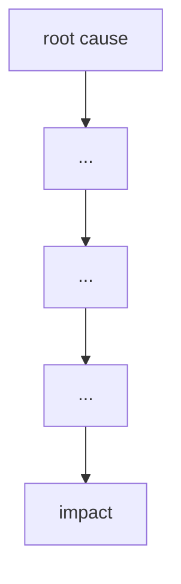

# Failure case analysis · <Mars Climate Orbiter, lost in 1999> (v1.0, 2026-10-20)
Authors: Ty Vannavuth <Section 1 and 2>

## 1. Context
Mars Climate Orbiter(MCO) was a $125 million robotic space probe launched by NASA on December 11, 1998, to study the Martian climate, atmoshere,and surface changes.It also had another job whic is to relaying radio communications for its sister mission, the Mars Polar Lander, which was due to land in December 1999.
After about nine and a half months of cruise, MCO was set to enter orbit around Mars. It would then spend weeks skimming the upper atmosphere (aerobraking) to settle into a lower orbit. The people relying on the software were the flight operations, navigation and science teams. The failure mattered because the mission was lost at its most critical moment, and because NASA were about to land the Polar Lander,they only had a few weeks to learn why the MOC failed and make sure the polar lander woild not meet the same failre.

## 2. Timeline
|    Date  |   Event  |
|----------|----------|
|1998-12-11|The MCO is launched from Cape Canaveral.|
|1999-04   |The MCO is in cruise phase, and the navigation team is using the spacecraft's telemetry data to determine its trajectory.|
|1999-09-08|The last planned course correction(TMC-4) is completed which aimed for the closest approach to mars of 226 Km.|
|1999-09-15|The plan is excecuted.|
|1999-09-23|The orbit-insertion burn starts at 09:00:46 UTC. Radio contact is lost behind Mars at 09:04:52 UTC, 49 seconds earlier than predicted, and never returns.|
|1999-09-29|Engineers find that the thruster data was in pound-force seconds instead of the specified Newton-seconds, so the effect was underestimated by a factor of 4.45.|
|1999-10-15|NASA sets up the Mishap Investigation Board.|
|1999-11-10|NASA published its Phase I report, which concluded that the main reason for the loss of the MCO was measurement mismatches.|

## 3. What failed
<one paragraph>

## 4. Root causes
| # | Root cause | Type | Essential difficulty | Why |
|---|------------|------|----------------------|-----|
| R1 |           | technical / process / organisational | | |

## 5. Practices that would have prevented or limited it
| Root cause | Practice | Chapter |
|------------|----------|---------|

## 6. Lessons for ITC Club Hub
1.
2.

## 7. Sources
1. <author or organisation, title, year, URL> (primary)
