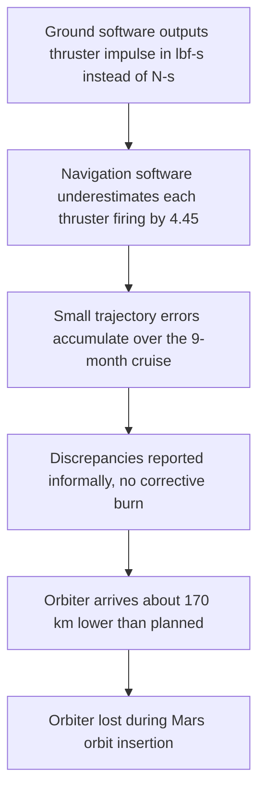

# Failure case analysis · <Mars Climate Orbiter, lost in 1999> (v1.0, 2026-10-20)
Authors: Ty Vannavuth <Section 1 and 2> , Phorst Chan Sereywattana <Section 3>, Keng Kolpanha <Section 4>, Chum Sovanthavrak <Section 5, 6 and 7>

## 1. Context
Mars Climate Orbiter(MCO) was a $125 million robotic space probe launched by NASA on December 11, 1998, to study the Martian climate, atmoshere,and surface changes.It also had another job whic is to relaying radio communications for its sister mission, the Mars Polar Lander, which was due to land in December 1999.
After about nine and a half months of cruise, MCO was set to enter orbit around Mars. It would then spend weeks skimming the upper atmosphere (aerobraking) to settle into a lower orbit. The people relying on the software were the flight operations, navigation and science teams. The failure mattered because the mission was lost at its most critical moment, and because NASA were about to land the Polar Lander,they only had a few weeks to learn why the MOC failed and make sure the polar lander woild not meet the same failre.

## 2. Timeline
|    Date  |   Event  |
|----------|----------|
|1998-12-11|The MCO is launched from Cape Canaveral.|
|1999-04   |The MCO is in cruise phase, and the navigation team is using the spacecraft's telemetry data to determine its trajectory.|
|1999-09-08|The last planned course correction(TMC-4) is completed which aimed for the closest approach to mars of 226 Km.|
|1999-09-15|The plan is excecuted.|
|1999-09-23|The orbit-insertion burn starts at 09:00:46 UTC. Radio contact is lost behind Mars at 09:04:52 UTC, 49 seconds earlier than predicted, and never returns.|
|1999-09-29|Engineers find that the thruster data was in pound-force seconds instead of the specified Newton-seconds, so the effect was underestimated by a factor of 4.45.|
|1999-10-15|NASA sets up the Mishap Investigation Board.|
|1999-11-10|NASA published its Phase I report, which concluded that the main reason for the loss of the MCO was measurement mismatches.|

## 3. What failed
The ground software that processes thruster-firing data (the "small forces" file) wrote its output in pound-force seconds, although the interface specification required Newton-seconds. The navigation software read those numbers as Newton-seconds, so it treated every firing as about 4.45 times weaker than it really was. These firings, which stop the reaction wheels from saturating, happened 10 to 14 times more often than the navigators expected because of the spacecraft's asymmetric solar array, so the small error added up over the nine-month cruise. By arrival, the real trajectory was about 170 km lower than the estimate, and the orbiter passed roughly 57 km above Mars instead of the planned 226 km, well below the 80 km considered survivable. The software on board the spacecraft was correct; the error was only in the ground software.  

## 4. Root causes
| # | Root cause | Type | Essential difficulty | Why |
|---|------------|------|----------------------|-----|
| R1 | Ground software produced thruster data in the wrong units, against the interface specification | technical | conformity | The software had to match an interface and unit convention defined outside the code, and it did not. |
| R2 | The interface specification was not used in developing and testing the ground software, and there was no end-to-end test or independent verification of it.| process | invisibility | A wrong unit gives plausible numbers, so nothing looks broken until the data is checked against the specification. |
| R3 | A design change (dropping the daily spacecraft flip that limited momentum build-up) was not passed on to the navigation team, who also assumed MCO behaved like the earlier Mars Global Surveyor | process | changeability | The design changed, but the downstream team's assumptions were never updated, so they expected far fewer thruster firings than occurred.|
| R4 | Doubts were raised by email instead of the formal anomaly process, in a culture that saw orbiting Mars as routine, with a thin navigation team covering several missions | organisational | complexity | Many teams and partners, plus three missions at once, made it easy for a warning to get lost between groups.|

## 5. Practices that would have prevented or limited it
| Root cause | Practice | Chapter |
|------------|----------|---------|
| R1 | Write the interface as an explicit requirement and put the unit in the name or type of every value | Ch5 |
| R2 | Interface and end-to-end tests that check generated files against the specification, plus independent review | Ch9 |
| R3 | Re-validate downstream assumptions whenever a design decision changes | Ch6  |
| R4 | Track every discrepancy as a formal issue with an owner, not in email or chat | Ch10  |

## 6. Lessons for ITC Club Hub
1. Our CSV files will have a fixed format written in the README (for example, date as YYYY-MM-DD HH:MM and capacity as a whole number from 1 to 500). The program rejects any file that does not match, so a wrong format cannot slip through unnoticed like the MCO unit error.
2. Any bug or doubt about the code or the data must be written as a GitHub Issue within 24 hours, not only mentioned in chat. At the end of each week, we check that every issue has an owner, so a warning cannot get lost like the MCO navigation team's concerns.

## 7. Sources
1. NASA, Mars Climate Orbiter Mishap Investigation Board, Phase I Report, 10 November 1999, https://llis.nasa.gov/llis_lib/pdf/1009464main1_0641-mr.pdf (primary)
2. NASA, Mars Climate Orbiter Mishap Investigation Board, Phase II Report, 2000, https://discovery.larc.nasa.gov/PDF_FILES/mars_climate_orbiter_phaseII.pdf (primary)
3. NASA, press release 99-134, "Mars Climate Orbiter failure board releases report", 10 November 1999, https://spacenews.com/?p=27024