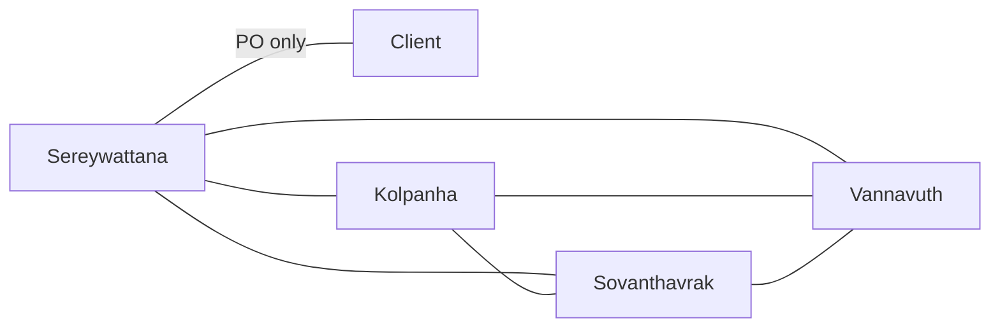

# Communication overhead · SteavInMotion (v1.0, 2026-10-21)

## Paths
| Model | People n | Paths n(n-1)/2 | Minutes/week | Hours/week |
|-------|----------|----------------|--------------|------------|
| (a) everyone + client | 5 | 10 | 100 | 1.7 | 
| (b) client via PO      | 4 | 7 | 70 | 1.2 |
- (a) 5 x 4 / 2 = 10 paths; (b) 4 x 3 / 2 + 1 = 7 paths
- Assumption: 10 minutes per path per week, because quick updates, async messages, and coordination overhead take around 10 minutes per communication channel weekly.\
- Team capacity: 4 members × 6 h = 24 h/week -> overhead = 5%

## Our paths (model b)

## Two practices
1. Daily Async Standup in Discord/Slack: Each member posts 3 bullet points daily (Done, To Do, Blockers) to reduce unnecessary direct synchronization channels. new overhead: 0.7 h/week

2. GitHub Issues & Project Board as Single Source of Truth: Centralize task tracking and requirement clarifications on GitHub issue threads to avoid fragmented messaging.new overhead: 0.5 h/week

## A fifth member in week 11?
- Adding a fifth member in week 11 increases model (b) paths from 7 to 11 paths ((5 * 4) / 2 + 1 = 11 paths, a +57% increase in communication overhead) and introduces onboarding   friction; therefore, following Brooks' Law ("adding manpower to a late software project makes it later"), we would not accept that offer.

## Reflection: Essential Difficulty in ITC Club Hub

- The essential difficulty our team will hit first in ITC Club Hub is **complexity**. Complexity happens because different parts of the system interact with each other in complicated ways. In ITC Club Hub, this complexity shows up when managing user roles, permissions, and club event approvals.
- For example, when a user submits a new event, the system has to check their role, verify their club membership, and update event status at the same time. This creates many moving parts where a small bug in permissions can break the approval process.
- Over the next four weeks, we will handle this by creating clear module boundaries and keeping our code organized into separate files (like `banner.hpp`). This will make the project easier to understand and test.
