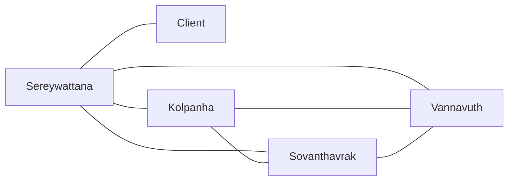

# Communication overhead · SteavInMotion (v1.0, 2026-10-21)

## Paths
(a) 4 members + client, all pairs:  5 x 4 / 2 = 10 paths
(b) client only via the PO:         4 x 3 / 2 + 1 = 7 paths
Assumption: 10 min per path per week
    (a) 100 min = 1.67 h/week    (b) 70 min = 1.17 h/week
Team capacity: 4 x 6 h = 24 h/week -> (b) costs about 5 %
Fifth member in week 11: 5 x 4 / 2 + 1 = 11 paths (+57 %)  

## Our paths (model b)

## Two practices
1. **Module owners**: Assigning specific subsystems (e.g., Keng Kolpanha for club registration logic, Chum Sovanthavrak for event approvals, Ty Vannavuth for the UI and banner interfaces, and Phorst Chan Sereywattana for core architecture) so questions about a component route directly to a single owner rather than broadcasting to the entire team.
   * **How it works in our team**: Instead of all four members debating every design detail of every component, each member takes full responsibility for designing, implementing, and reviewing their assigned module.
   * **New overhead**: ~0.5 h/week.

2. **GitHub Issues as the single source of truth**: Centralizing all task assignments, bug tracking, and design decisions into GitHub Issues rather than scattering conversations across fragmented chat apps.
   * **How it works in our team**: Every task or blocker is tied to a specific issue thread where updates are logged asynchronously, cutting down ad-hoc messaging and synchronizing everyone instantly.
   * **New overhead**: ~0.4 h/week.

## Reflection: Essential Difficulty in ITC Club Hub

The essential difficulty our team will hit first in ITC Club Hub is **complexity**. Complexity happens because different parts of the system interact with each other in complicated ways. In ITC Club Hub, this complexity shows up when managing user roles, permissions, and club event approvals.

For example, when a user submits a new event, the system has to check their role, verify their club membership, and update event status at the same time. This creates many moving parts where a small bug in permissions can break the approval process.

Over the next four weeks, we will handle this by creating clear module boundaries and keeping our code organized into separate files (like `banner.hpp`). This will make the project easier to understand and test.
