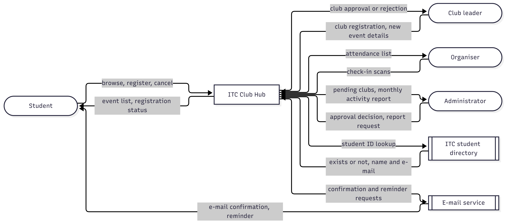
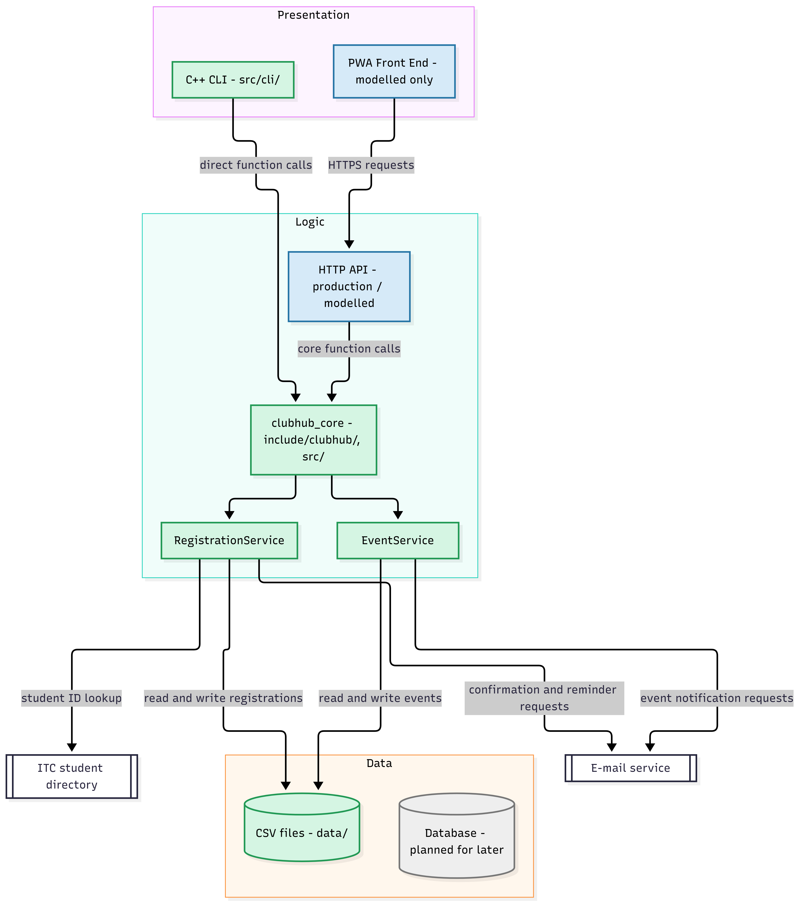

# Lab-02 · What changed (types of applications, quality, architecture, C++ core)
Version 1.0 · 2026-11-04 · Team: SteavInMotion

## Files of this lab

| File | Description | Main author |
|------|-------------|-------------|
| `lab02/app-classification.md` | Five everyday applications classified: kind, types, where the code runs, architecture, top 3 qualities | SteavInMotion |
| `lab02/app-quadrant.mmd` | Quadrant chart: timing demand against availability demand | Chum Sovanthavrak |
| `lab02/adr-001-application-type.md` | ADR-001: PWA for students, organisers and administrators, with an offline check-in queue | Chum Sovanthavrak |
| `lab02/quality-scenarios.md` | Six quality attribute scenarios QAS-01..06 and the priority table | SteavInMotion |
| `lab02/context-diagram.mmd` + `.png` | Context diagram: Club Hub as one black box, four roles, two external systems | Ty Vannavuth |
| `lab02/architecture.mmd` + `.png` | Three-tier sketch, implemented and modelled parts mapped to folders | Phorst Chan Sereywattana |
| `include/clubhub/event.hpp`, `src/event.cpp` | `Event` class, `TimePoint` (std::chrono), `parseTimePoint`, `formatTimePoint` | SteavInMotion |
| `include/clubhub/event_csv.hpp`, `src/event_csv.cpp` | CSV loader that collects bad rows in `errors` | SteavInMotion |
| `src/cli/main.cpp` | `list-events` command; the only file that prints | SteavInMotion |
| `CMakeLists.txt` | Targets `clubhub_core` (library) and `clubhub` (executable) | Chum Sovanthavrak |
| `data/events.csv` | Sample events, including the invalid row E004 | Chum Sovanthavrak |
| `lab02/challenge/offline-checkin.md` | Challenge: offline-first check-in design |  SteavInMotion |
| `include/clubhub/queued_checkin.hpp` | Challenge: `QueuedCheckIn` and `CheckInQueue` |  SteavInMotion |

## Inputs reused
Get the commit hash with `git log -1 --format=%h -- <file>`.

| Lab-01 file | Version or commit | Used for |
|-------------|-------------------|----------|
| `lab01/team-charter.md` | `a808f1d` | Problem statement, stakeholders, team roles (Task 2, Task 4) |
| `lab01/decisions.md`    | `0493f32` | Decision rules; line added that points to ADR-001 |

## Diagrams
Context diagram:



Three-tier architecture:



## How to build and run
```
cmake -S . -B build && cmake --build build && ctest --test-dir build
./build/clubhub list-events data/events.csv
```
Row E004 has capacity 0, so the command prints `data/events.csv:5: skipped: capacity must be positive` on stderr and exits with code 1.

## Change log
| Date | Version | What changed | By whom |
|------|---------|--------------|---------|
| 2026-11-04 | 1.0 | Lab-02 documents, diagrams, `Event` core, CSV loader, `list-events` CLI, README | SteavInMotion |