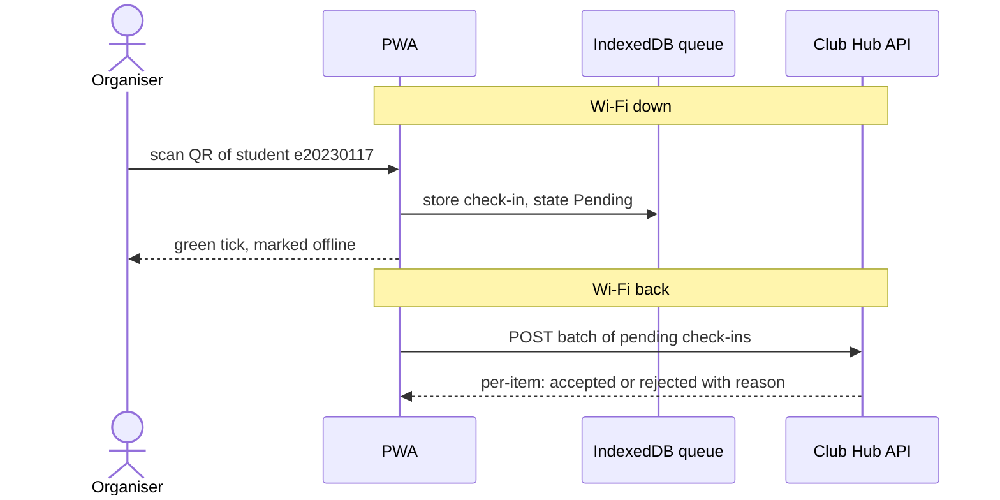

# Challenge: Offline-First Check-In Architecture for a PWA

## Scenario Overview
During events like Debate Night in Amphi A, Wi-Fi connectivity can drop out while high volumes of students arrive through multiple doors staffed by organisers running the Club Hub PWA. Check-ins must never block on the network: each phone records check-ins locally, queues them, and synchronises with the server when connection is restored.

---

## 1. Sequence Diagram

---

## 2. Conflict Rules

| # | Case | Winner | Organiser sees | Stored on the server |
|---|------|--------|----------------|----------------------|
| 1 | same student scanned at both doors | Both (Earliest scan timestamp wins priority) | Green tick (success) at both doors | Keeps earliest scan timestamp, logs both devices |
| 2 | registration cancelled on the server meanwhile | Server (Single source of truth) | Red cross / warning: "Registration cancelled" | Rejected; check-in denied |
| 3 | student not registered at all | Server (Single source of truth) | Red cross / warning: "Student not registered" | Rejected; check-in denied |
| 4 | upload retried after a timeout, server had applied it | Server (First copy) | Green tick (success confirmation) | The server keeps a set of applied localIds; a second POST with the same localId returns "accepted" again without a second record |
| 5 | phone clock 7 minutes wrong | Server `receivedAt` for absolute time; device order for local queue | Green tick immediately | Server records `receivedAt` alongside relative sequence order |

---

## 3. C++ Data Structure & Idempotency Strategy
The data structure is implemented in `include/clubhub/queued_checkin.hpp` using `SyncState`, `QueuedCheckIn`, and `CheckInQueue`. 

**Idempotency Explanation**: A unique `localId` UUID is generated on the device upon scanning. Because network timeouts can cause an HTTP POST request to be retried even after the server successfully processed the initial attempt, the server keeps a set of applied `localId`s. A second POST with the same `localId` returns `accepted` without creating a duplicate record. Furthermore, server `receivedAt` timestamps are used to prevent clock drift issues across phones, and server rejections are pushed directly to the organiser's screen.

---

## 4. Quality Scenarios & Trade-offs
- **Impact on QAS-01..06**: Offline-first significantly improves **Availability** and **Performance/Latency** by eliminating network blocking during high-density door arrivals. It hardens **Consistency**, shifting from immediate consistency to eventual consistency where capacity could temporarily stretch by a few seats if two offline doors check in students simultaneously near max capacity.
- **New Quality Scenario (5-Minute Outage)**:
  - **Source**: Event Organiser at the door
  - **Stimulus**: A 5-minute Wi-Fi outage occurs while processing arrivals
  - **Artifact**: Club Hub PWA and local `IndexedDB` queue
  - **Environment**: High-density room (Amphi A) with flaky network
  - **Response**: The PWA successfully queues all scans locally with zero blocking delay, gives immediate green feedback, and automatically synchronizes the complete batch upon reconnection
  - **Response Measure**: 0% dropped check-in scans, and sync completion under 10 seconds post-reconnection.