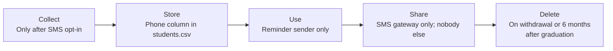

# Data inventory · ITC Club Hub
Version 1.0 · 2026-11-11 · Authors: Phorst Chan Sereywattana, Ty Vannavuth

| Field | Subject | Purpose | Legal basis / consent | Retention | Who can see it | Stored in | Decision |
|-------|---------|---------|-----------------------|-----------|----------------|-----------|----------|
| studentId | student | Identify the student; block double registration for the same event | Necessary for the service: the "one registration per event" rule cannot work without a unique key | Until the account is deleted, otherwise 6 months after graduation | Student: own, in full. Administrator: in full. Organiser and club leader: masked (e2******7) | data/students.csv | **Mask** for organisers and club leaders: name plus masked ID is enough to find a person at the door, and full IDs are not needed to run an event |
| name | student | Door check-in list for organisers; member list for club leaders; registration confirmation | Necessary for the service: organisers must recognise who is checking in | Until the account is deleted, otherwise 6 months after graduation | Student: own. Organiser: students registered for their events only. Club leader: members of their own club only. Administrator: yes | data/students.csv | **Keep**: a check-in list without names cannot be used at the door |
| email | student | Registration and cancellation confirmations; optional email reminders | Necessary for the service (confirmations). Consent, opt-in, for reminders | Until the account is deleted, otherwise 6 months after graduation | Student: own. Administrator: yes. Nobody else on screen; read by the mail sender only | data/students.csv | **Keep**: needed to confirm a registration; reminders by email stay off until the student turns them on |
| phone | student | SMS reminder 24 h before an event, only if chosen | Consent, opt-in, withdrawable in *My profile* | Deleted at once on withdrawal, otherwise 6 months after graduation | Nobody on screen; read only by the reminder sender | data/students.csv (phone column) | **Keep optional**: SMS reaches students without mobile data, but no feature needs it for everyone |
| clubMemberships | student | Club leader's member list; "my clubs" screen; counts in the monthly report | Necessary for the service: a club cannot be managed without knowing its members | Until the student leaves the club or deletes the account, otherwise 6 months after graduation | Student: own. Club leader: members of their own club only. Administrator: counts per club, not names | data/memberships.csv | **Keep**: it is the core of the club feature, and leaders see only their own club |
| attendance | student | Check-in at the door; capacity and attendance for the organiser; monthly activity report for the clubs office | Legitimate interest: the institute needs to know who actually came so that cancelled or no-show registrations are not counted as attendance. The interest ends once the report is made, so identified records are kept only for corrections | Identified for 3 months after the event (to fix mistakes and disputes), then only counts per event | Student: own history. Organiser: attendance of their own events during the 3 months. Administrator: counts only | data/registrations.csv | **Aggregate**: after 3 months only the number per event and month is kept, because the report needs counts, not names |
| dateOfBirth | student | None: no feature, rule or report uses it | None | Not collected | Nobody | Not stored | **Drop**: "might be useful" is not a purpose |
| photo | student | None: no screen shows a photo; check-in uses name plus masked ID | None | Not collected | Nobody | Not stored | **Drop**: a face photo identifies a person and gives no benefit to any feature |
| facultyAndYear | student | None today; only a possible wish of the clubs office for statistics | None | Not collected | Nobody | Not stored | **Drop**: no rule or report uses it; if the clubs office needs statistics later, it asks first and we collect it as optional, with a purpose |

## Copies of personal data
| Copy | Rule |
|------|------|
| log files | only redacted() output, never name, email or phone |
| CSV exports | Export only the columns needed for the stated purpose: door list = name plus masked ID; monthly report = counts only. No phone or email in any export. The person who exports deletes the file after use (at most 7 days), and exports are never sent through chat apps or public drives. |
| test fixtures | Invented data only (IDs such as e2099xxxx, emails at example.edu, numbers like 012 345 678). No real student, not even a team member. A reviewer checks fixtures in each pull request. |
| backups | Same access as production (administrator only) and encrypted. Backups expire after 30 days, so a deleted or purged record disappears from backups within a month. After a restore, the purge rules from retention-rules.md run again before the system goes live. |
| screenshots in docs | Use the invented demo data set only. If a real screen must be shown, crop or blur names, IDs, emails and phones before committing. A screenshot is reviewed like code. |

## Lifecycle of the phone field

## Client feedback

- Date: 2026-11-11 · Client: <Seav Muy> · Product Owner: Phorst Chan Sereywattana
- Objection 1: No objection raised. Drop decisions accepted as written.
- Prepared points for the five minutes:
  - facultyAndYear: the clubs office may ask for faculty statistics. Offer an optional field added later with a named purpose, or counts from the registrar.
  - Sponsors may ask for contact lists. Answer: counts only; no personal data leaves the institute.
  - Attendance: the client may want identified history for longer. Answer: counts are enough for the report, and a longer period needs a written purpose.