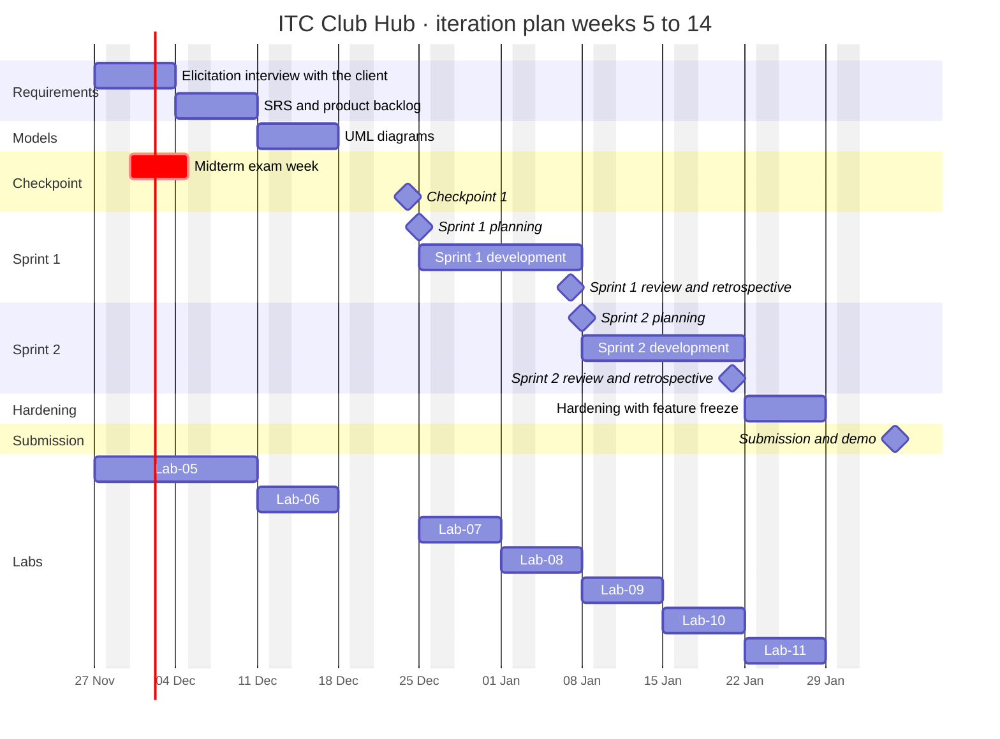

# Iteration plan · Team SteavInMotion · v1.0 (2026-11-25)

Plan for weeks 5 to 14 of the semester, following the process we chose in `process-decision.md` (Scrum-style sprints after an up-front requirements and modelling phase).

**Assumption to check:** week 5 starts on Monday 2026-11-16. If your semester calendar differs, shift every date in the chart by the same number of days.

| Week | Starts | What happens |
|------|--------|--------------|
| 5 | 2026-11-27 | Elicitation interview, Lab-05 starts |
| 6 | 2026-12-04 | SRS and product backlog |
| 7 | 2026-12-11 | UML models (Lab-06) |
| 8 | 2026-12-18 | Midterm exam week, Checkpoint 1 on Friday |
| 9 | 2026-12-25 | Sprint 1 planning and development |
| 10 | 2027-01-01 | Sprint 1 development, review and retrospective on Friday |
| 11 | 2027-01-08 | Sprint 2 planning and development |
| 12 | 2027-01-15 | Sprint 2 development, review and retrospective on Friday |
| 13 | 2027-01-22 | Hardening: bug fixes only |
| 14 | 2027-01-29 | Submission and demo |

The lab bars for Lab-07 to Lab-11 are one lab per week from week 9; adjust them to the real lab calendar. They show that lab work and sprint work compete for the same hours.

## Iteration goals

Capacity = members × hours per week × weeks × 0.8. We use 4 members and 6 hours per person per week (the course default). Replace 6 with the number from the team charter if it differs.

| Iteration | Weeks | Goal | Candidate features | Capacity | Exit criterion |
|-----------|-------|------|--------------------|----------|----------------|
| Sprint 1 | 9-10 | A student can browse upcoming events and register from the CLI, and only approved clubs can publish events | Browse events; register (capacity, no duplicate, no past event); club registration and approval | 4 × 6 × 2 × 0.8 = 38.4 h | Stories demoed to the TA; tests for the three rules green in CI |
| Sprint 2 | 11-12 | A student can cancel, an organiser can check students in, and the administrator sees a monthly report | Cancel (24 h rule); check-in and attendance; monthly report counting only checked-in students; reminder and waiting list only if time remains (Should) | 4 × 6 × 2 × 0.8 = 38.4 h | Stories demoed to the TA; regression tests for the 24 h rule and the report green in CI |
| Hardening | 13 | A stable build ready to demo. This is not a third sprint: no new features, only fixes, documentation and demo rehearsal | Bug fixes; known-issues list; README and notices; demo script | 4 × 6 × 1 × 0.8 = 19.2 h | Clean checkout builds and all tests pass; known issues are fixed or listed; demo rehearsed once |

**Plausibility check:** each sprint has about 38 hours. Sprint 1 has three features, so about 10 hours each for code, tests and CLI, with a few hours for planning and review. Sprint 2 has three features of similar size, which is why the reminder and the waiting list are only done if time remains. The privacy-aware `Student` class from Lab-03 already exists, so Sprint 1 does not need to build it again.
