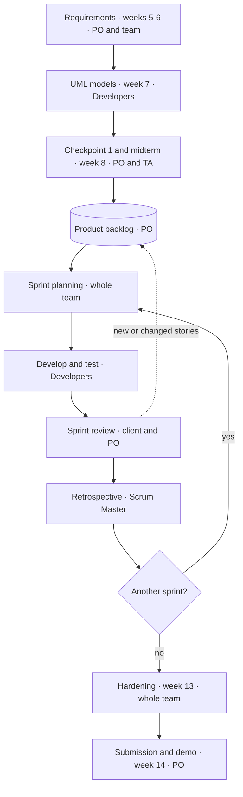

# PDR-001 · Development process for ITC Club Hub
Status: Proposed
Date: 2026-11-19        Deciders: Phorst Chan Sereywattana, Chum Sovanthavrak, Keng Kolpanha, Ty Vannavuth

## Context
1. The team has 4 members and each can give about 6 hours per week (source: lab01/team-charter.md, fallback value, confirm).
2. The client (instructor or TA) is available about 30 minutes per week (source: case-study brief).
3. Fixed milestones are checkpoint 1 in week 8 and project submission and demo in week 14 (source: case-study brief).
4. Requirements are not yet clear: the client interview and SRS happen in weeks 5-6, and the waiting list and reminders are still open (source: lab01/problem-statement.md and case-study brief).
5. The team is experienced in C++ from last year's course, has used Git for only a few months, met CMake only at the start of this course, and has never run sprints (source: team self-assessment).
6. The core must enforce five business rules: capacity, no duplicate registration, 24-hour cancellation, no past events, approved clubs only (source: case-study brief).
7. Team members share the roles Product Owner (Phorst Chan Sereywattana), Scrum Master (rotating, Chum Sovanthavrak then Ty Vannavuth) and Developers, and the team agreed to review each other's code before merging (source: lab01/team-charter.md).

## Options considered
| Option                   | Weighted score (Task 2) | Pro | Con |
|--------------------------|------------------------:|-----|-----|
| A. Waterfall             | 2.55 | Simple plan with clear phases that is easy to explain. | Client feedback and testing come too late, and requirements are not stable yet. |
| B. Incremental delivery  | 3.85 | Delivers working parts early, so bugs show sooner. | No fixed review rhythm, so requirement changes are handled less formally. |
| C. Scrum-style iterative | 4.00 | Sprint reviews match the client's 30 minutes a week and absorb new stories. | The team has never run sprints, so the ceremonies and roles take practice. |
| D. No defined process    | n/a  | No planning overhead. | Nobody knows who does what or when, the week 8 and week 14 deadlines are at risk, and individual contributions are hard to show in Git. |

## Decision
We will use a hybrid: an up-front requirements and modelling phase (weeks 5-8) followed by two Scrum-style sprints (weeks 9-12) and a hardening week (week 13). This is the Task 2 winner (Scrum-style, 4.00) combined with a short plan-driven start, because the SRS, UML models and checkpoint 1 must be reviewed before any sprint begins.

| Element | Reference practice | Our tailoring | Reason |
|---------|--------------------|---------------|--------|
| Up-front work | Scrum starts from a product backlog | Requirements (weeks 5-6) and UML models (week 7) before Sprint 1 | Checkpoint 1 in week 8 reviews requirements and models. |
| Iteration length | 2-4 week sprints | 2 weeks, only two sprints (weeks 9-10 and 11-12) | The semester leaves only weeks 9-12 for development. |
| Meetings | Daily scrum, planning, review, retrospective | One team meeting a week on Google Meet or at ITC, planning on the first Monday and review with retrospective on the last Friday of each sprint, Telegram for daily questions | About 6 hours per person per week is too little for daily meetings. |
| Roles | Product Owner, Scrum Master, Developers | Wattana is Product Owner all semester, Scrum Master is Thavrak in Sprint 1 and Vuth in Sprint 2, Vuth and Panha are Developers | Matches the charter and shares the learning of the Scrum role. |
| Documents | Light documentation | SRS, UML models, PDR, iteration plan, CHANGELOG, README per lab, decisions in lab01/decisions.md | Course deliverables and traceability for the client. |
| Definition of Done | Team-defined | Code reviewed in a pull request, GoogleTest tests green in CI, demoed to the TA | Follows the charter rules on testing and code review. |
| Hardening | Not part of Scrum | Week 13: no new features, only fixes, documentation and demo rehearsal | Protects the week 14 demo. |

## Consequences
Positive:
- The client sees working software at the end of both sprints, so misunderstandings are found early.
- Business-rule bugs are caught inside sprints, not at the end.
- Every member has visible work through pull requests, reviews and the rotating Scrum Master role.
- Rotating the Scrum Master means two members learn the process from the inside.

Negative / risks (with mitigation):
- Only two sprints, so a story that slips from Sprint 1 has just one more chance. Mitigation: plan the Must stories first and keep the sprint backlog small.
- The team has never run sprints and may run the ceremonies badly. Mitigation: keep meetings short, use the Sprint 1 retrospective to adjust, and let the Scrum Master prepare a simple checklist.
- Git and CMake are still new, so build or merge problems could cost time. Mitigation: small pull requests, a clean-build check before every merge and one member (DevOps hat) as first contact for build issues.
- The client is available only about 30 minutes a week, so questions may wait. Mitigation: collect questions in one GitHub Issue and send them before each weekly meeting.
- Lab work and the week 8 exam compete with project time. Mitigation: no sprint work in exam week, and the iteration plan shows the lab deadlines.

## Process diagram (source: lab04/process.mmd)

## Approvals
- Phorst Chan Sereywattana, 2026-11-19: approved
